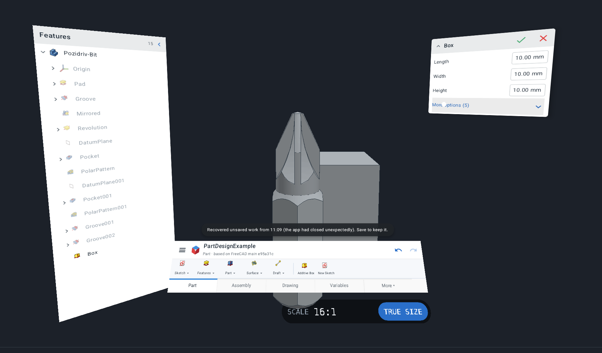
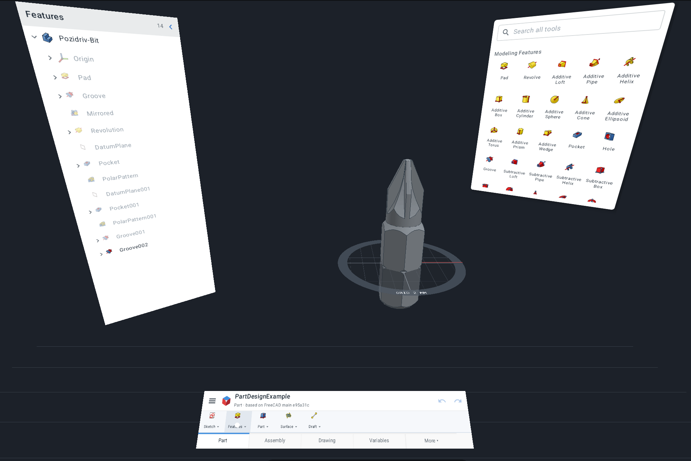
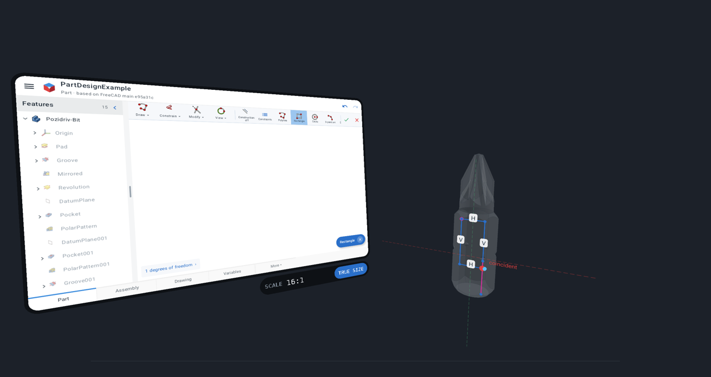
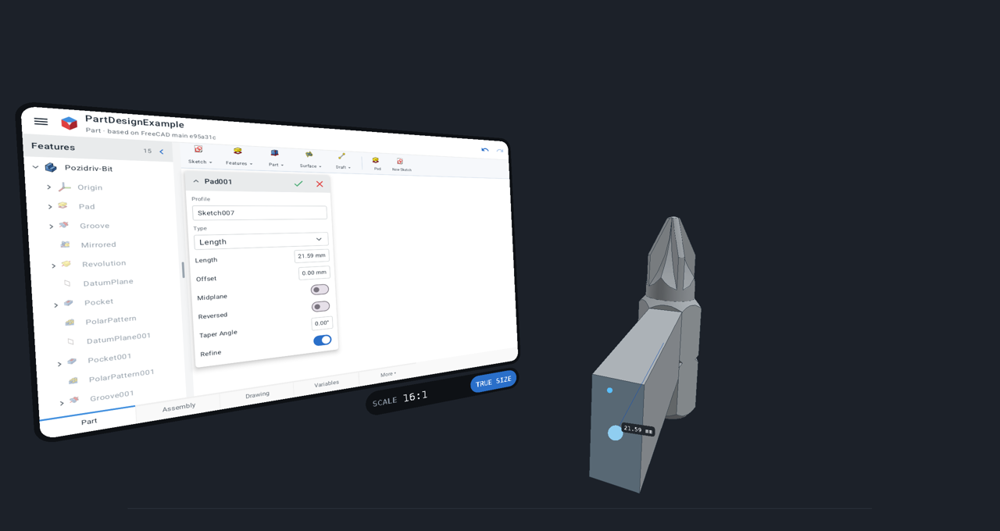
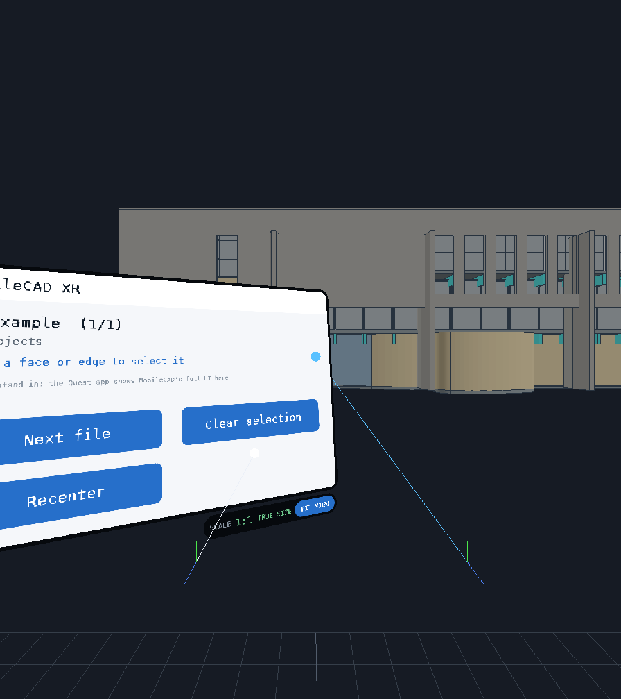

# MobileCAD XR

Parametric CAD in the headset, on **Meta Quest 3** (and other Android OpenXR headsets): a variation of
[MobileCAD](https://github.com/LucasCoraca/mobilecad) that puts the **whole MobileCAD app** in front of you, with the
part you are building in 3D in the room and the interface arranged around you. It comes with a **headset-free test bench**, so you can develop and
try it without a Quest.



## Modelling in the headset

MobileCAD XR is MobileCAD, with its 3D view taken out of the screen and put into the room, and its interface laid out
around you like a desk with three monitors, with nothing behind it, so the model shows through wherever the UI draws nothing:

- **left:** the feature tree, turned towards you;
- **ahead, under the model:** the top bar, the tool strip (or the sketch tools) and the workbench tabs, tilted up towards
  your hands like a keyboard; banners, selection chips, menus and dialogs float above it, over the model;
- **right:** the docked panels: tool panels, feature dialogs, task panels, the sketch's constraint list, the number pad.

Every window can be moved on its own: grip it and put it where you like (A / X puts them all back). Menus and dialogs
are shown whole, each on its own surface.

The model stands on a **build plate**: a see-through tabletop on its ground plane (FreeCAD's XY plane) around the
3D origin, with a grid (its spacing printed on the rim) and the X / Y / Z axes. It is the table you work on: grab its rim
with the grip to pick it up and carry it (it turns with your wrist and stays level), or point at the rim and pull the
trigger to slide it around. A new document keeps the table where you put it; an empty one shows just the plate, ready
for a first sketch.



It is the whole app: every workbench and tool (sketcher, Part Design, fillets and chamfers, patterns, booleans,
assemblies, FEM, drawings), feature dialogs with the number pad, the feature tree, undo, files. Menus and dialogs close
when you click outside them, the model included, as on a touch screen. The model **is** the 3D view: the controller ray goes through MobileCAD's own view code, so everything you do with a
finger on the phone you do in 3D with the trigger, with the same tools and the same results:

- **Pick** faces, edges and vertices (only visible ones, as in FreeCAD); pointing pre-selects, like a mouse on desktop.
- **Sketch on the model**: open a sketch on a face and draw on it in the room. Every sketch tool works there with the
  sketcher's own snapping (part vertices, coincident, horizontal / vertical, on curve) and shows its own constraints,
  dimensions and live sizes, drawn on the sketch plane while the model fades.
- **Draft tools** take their points in the room through the Draft snapper (working plane, grid, object snaps).
- **Drag arrows** (Pad / Pocket length and other quantities) are dragged in 3D.




| Controller | On the interface | In the room (the model, the space around it) |
|---|---|---|
| Trigger | Tap / drag, like a finger | Like a finger on MobileCAD's view: tap picks, places sketch points and Draft points; drag drags (sketch geometry, dimension labels, arrows); double tap clears the selection |
| Pointing | Hover | Pre-selection, and the sketch / Draft tool's preview follows the ray |
| Grip | Move that window | Grab the model: move and turn it with your hand · on the build plate's rim: pick the table up and carry it |
| Trigger on the build plate's rim | | Slide the table where the ray points |
| Both grips | | Scale and turn the model between your hands |
| Thumbstick | Scroll | Up/down scales, left/right turns (about the origin) |
| B / Y | | The view's context menu (a two-finger tap on the phone) |
| A / X | Put the windows back and the table in front of you | |
| Scale badge (under the tool bars) | **TRUE SIZE**: the model at its real size, 1 mm = 1 mm · **FIT VIEW**: back to the scaled view | |

### True size

The badge under the tool bars always shows the model's scale (`SCALE 1:4.2`, `16:1`). **TRUE SIZE** switches to 1:1:
a small part stays where it is (a 25 mm bit really is 25 mm in your hand), a part bigger than arm's reach is stood on
the floor in front of you so you can walk around it (a building at full size). In true size the scaling gestures only
move and turn the model, so the scale can't drift; **FIT VIEW** puts the model back where and how big it was. Free
scaling with both hands also snaps to 1:1 as you pass it.



A typical flow: point at a face and click it, tap **Sketch → New Sketch** on the tool bar, pick Rectangle and click two
corners on the face, close the sketch (✓), tap **Pad**, then drag its arrow out of the part (or type the length on the
number pad). FreeCAD's example projects ship
with the app (Part Design, Assembly, FEM, BIM, Part); open your own `.FCStd` files from the ☰ menu.

**Install on a Quest 3:** enable developer mode (Meta Horizon app → Devices → Developer mode), connect the headset by
USB, then `adb install MobileCAD-XR-quest.apk` (or drag the APK into Meta Quest Developer Hub). It appears under
*Library → Unknown sources*.

## Test without a headset

Two ways, covering different parts:

- **The whole app, on the Android emulator** (or a phone): without an OpenXR runtime MobileCAD XR shows a preview of
  the XR scene: MobileCAD's full UI around you and the model in 3D. One finger is the controller with its trigger pressed
  (on the UI, and on the model / in the space around it: pick, sketch, place points, drag arrows); two fingers look
  around. This exercises everything except the OpenXR runtime itself
  (`./gradlew :app:assembleX86Debug`, install, run).
- **The OpenXR path, on a simulated headset** (below).

### Simulated headset

`sim/` is a Docker image with **Monado**, the open-source OpenXR runtime, using its *qwerty* driver: a simulated headset
and two controllers driven by keyboard and mouse, on a virtual display with software rendering (no GPU needed). The
desktop build of MobileCAD XR (`desktop/`) runs the **same XR core** as the Quest app against it.

```sh
sim/run.sh          # then open http://localhost:6080/vnc.html and press Connect
sim/run.sh --test   # automated: scripted controller picks on the model, grabs and moves it, clicks a panel button, switches true size on and off
```

In the browser, click into the **Monado!** panel on the right, then:
`W A S D` / `Q E` move the headset · arrows or right-drag look · hold `Ctrl` = left controller, hold `Alt` = right
controller · left click = trigger (click selects, hold grabs) · middle click = grip · `N` = menu (next file) ·
`T F G H` = thumbstick.

MobileCAD's Android UI cannot run on Linux, so the desktop build shows a small stand-in panel with real buttons to test
the panel interaction. The scenes it loads (`scenes/*.mcxr`) are FreeCAD's examples exported by MobileCAD's engine
(`tools/export_scenes.py`, run inside the phone app with `mobilecad/engine/fcrun.sh`).

## How it is built

| Path | What |
|---|---|
| `core/` | The XR core, shared by both builds: OpenXR session and controller actions (`xr_session`), interaction (`interaction`), GL renderer for OpenGL ES 3 and desktop GL 3.3 (`renderer`), FreeCAD meshes and face picking (`scene`) |
| `android/` | The headset app (Gradle). Compiles all of MobileCAD from the submodule; `XrActivity.kt` runs MobileCAD's Compose UI (its XR layout) on a see-through virtual display whose SurfaceTexture is cut into the surfaces around you (`arrangeSheets`; the image's alpha, read back a few times a second, decides where a ray hits the UI or passes through to the model), turns controller rays into touches on the UI and into MobileCAD's view (`ViewportView.xrPointer`: a virtual camera
looking down the ray), and sends what that view draws (the model, preselection, overlay, the sketch rendered by its own editor onto a texture on the sketch plane) to the XR scene; `xr_android.cpp` runs the core on an OpenXR thread (or the touch preview). Flavors: `arm64` (Quest), `x86` (emulator) |
| `desktop/` | Linux build of the core against any OpenXR runtime (Monado), with a mirror window, `--screenshot` and `--autotest` |
| `sim/` | The headset-free test bench (Monado + Xvfb + noVNC in Docker) |
| `mobilecad/` | [MobileCAD](https://github.com/LucasCoraca/mobilecad) as a git submodule: the FreeCAD engine, its build scripts and runtime packaging |

Build the Quest APK (after building MobileCAD's native runtime, see its README):

```sh
git submodule update --init
python3 -I mobilecad/engine/package_runtime.py arm64-v8a android
cd android && ./gradlew :app:assembleArm64Release
```

## License

GPL-3.0-or-later, like MobileCAD. Includes FreeCAD (LGPL-2.1-or-later), the Khronos OpenXR loader (Apache-2.0) and
MobileCAD's other components (see MobileCAD's About ▸ Open-source licenses). The test bench uses Monado (Boost
Software License 1.0), installed from Ubuntu's packages. MobileCAD XR is an independent project, not affiliated with,
sponsored or endorsed by the FreeCAD project, Meta or the Khronos Group. FreeCAD is a trademark of the FreeCAD Project
Association; Meta Quest is a trademark of Meta Platforms; OpenXR is a trademark of the Khronos Group.
