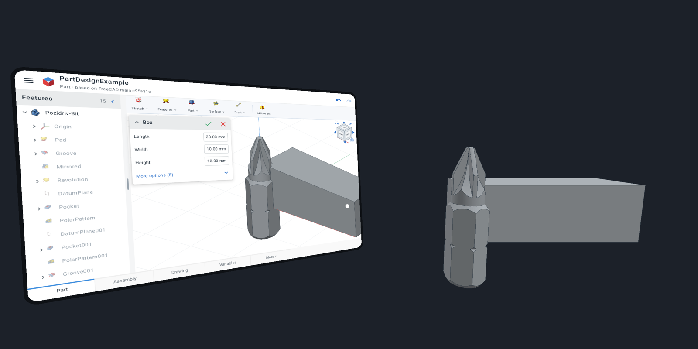

# MobileCAD XR

Parametric CAD in the headset, on **Meta Quest 3** (and other Android OpenXR headsets): a variation of
[MobileCAD](https://github.com/LucasCoraca/mobilecad) that puts the **whole MobileCAD app** in front of you, with the
part you are building standing next to it in 3D. It comes with a **headset-free test bench**, so you can develop and
try it without a Quest.



## Modelling in the headset

The floating panel is MobileCAD itself: every workbench and tool (sketcher, Part Design, fillets and chamfers,
patterns, booleans, assemblies, FEM, drawings), feature dialogs with the number pad, the feature tree, undo, files.
You use it with the controller ray like a touch screen. The model stands next to it, life-size or scaled, and stays in
sync with the document: features you add appear in 3D as you type their values, and what you pick in 3D is what the
tools act on.

| Controller | On the panel | On the model |
|---|---|---|
| Trigger | Tap / drag (buttons, number pad, sketching in the panel's view) | Click: pick the face or edge (adds it to the selection) |
| Hold trigger | Drag | Grab: move and turn the model with your hand |
| Grip | Move the panel | Grab the model |
| Both hands | | Scale and turn the model between your hands |
| Thumbstick | Scroll | Up/down scales, left/right turns |
| A / X (menu) | Bring the panel and the model back in front of you | |
| Scale badge (under the panel) | **TRUE SIZE**: the model at its real size, 1 mm = 1 mm · **FIT VIEW**: back to the scaled view | |

### True size

The badge under the panel always shows the model's scale (`SCALE 1:4.2`, `16:1`). **TRUE SIZE** switches to 1:1:
a small part stays where it is (a 25 mm bit really is 25 mm in your hand), a part bigger than arm's reach is stood on
the floor in front of you so you can walk around it (a building at full size). In true size the scaling gestures only
move and turn the model, so the scale can't drift; **FIT VIEW** puts the model back where and how big it was. Free
scaling with both hands also snaps to 1:1 as you pass it.


A typical flow: point at a face and click it, then on the panel tap **Sketch** → draw on that face in the panel's
view → **Pad** → type the length on the number pad → the solid grows in front of you. FreeCAD's example projects ship
with the app (Part Design, Assembly, FEM, BIM, Part); open your own `.FCStd` files from the panel's ☰ menu.

**Install on a Quest 3:** enable developer mode (Meta Horizon app → Devices → Developer mode), connect the headset by
USB, then `adb install MobileCAD-XR-quest.apk` (or drag the APK into Meta Quest Developer Hub). It appears under
*Library → Unknown sources*.

## Test without a headset

Two ways, covering different parts:

- **The whole app, on the Android emulator** (or a phone): without an OpenXR runtime MobileCAD XR shows a preview of
  the XR scene: the panel with MobileCAD's full UI and the model in 3D. Touch the panel to use it, drag elsewhere to look
  around, tap the model to pick faces and edges. This exercises everything except the OpenXR runtime itself
  (`./gradlew :app:assembleX86Debug`, install, run).
- **The OpenXR path, on a simulated headset** (below).

### Simulated headset

`sim/` is a Docker image with **Monado**, the open-source OpenXR runtime, using its *qwerty* driver: a simulated headset
and two controllers driven by keyboard and mouse, on a virtual display with software rendering (no GPU needed). The
desktop build of MobileCAD XR (`desktop/`) runs the **same XR core** as the Quest app against it.

```sh
sim/run.sh          # then open http://localhost:6080/vnc.html and press Connect
sim/run.sh --test   # automated: scripted controller picks on the model, grabs and moves it, clicks a panel button, switches true size on and off
```

In the browser, click into the **Monado!** panel on the right, then:
`W A S D` / `Q E` move the headset · arrows or right-drag look · hold `Ctrl` = left controller, hold `Alt` = right
controller · left click = trigger (click selects, hold grabs) · middle click = grip · `N` = menu (next file) ·
`T F G H` = thumbstick.

MobileCAD's Android UI cannot run on Linux, so the desktop build shows a small stand-in panel with real buttons to test
the panel interaction. The scenes it loads (`scenes/*.mcxr`) are FreeCAD's examples exported by MobileCAD's engine
(`tools/export_scenes.py`, run inside the phone app with `mobilecad/engine/fcrun.sh`).

## How it is built

| Path | What |
|---|---|
| `core/` | The XR core, shared by both builds: OpenXR session and controller actions (`xr_session`), interaction (`interaction`), GL renderer for OpenGL ES 3 and desktop GL 3.3 (`renderer`), FreeCAD meshes and face picking (`scene`) |
| `android/` | The headset app (Gradle). Compiles all of MobileCAD from the submodule; `XrActivity.kt` runs MobileCAD's Compose UI on a virtual display whose SurfaceTexture is the panel, turns controller rays into touches, and keeps the 3D model in sync with the document; `xr_android.cpp` runs the core on an OpenXR thread (or the touch preview). Flavors: `arm64` (Quest), `x86` (emulator) |
| `desktop/` | Linux build of the core against any OpenXR runtime (Monado), with a mirror window, `--screenshot` and `--autotest` |
| `sim/` | The headset-free test bench (Monado + Xvfb + noVNC in Docker) |
| `mobilecad/` | [MobileCAD](https://github.com/LucasCoraca/mobilecad) as a git submodule: the FreeCAD engine, its build scripts and runtime packaging |

Build the Quest APK (after building MobileCAD's native runtime, see its README):

```sh
git submodule update --init
python3 -I mobilecad/engine/package_runtime.py arm64-v8a android
cd android && ./gradlew :app:assembleArm64Release
```

## License

GPL-3.0-or-later, like MobileCAD. Includes FreeCAD (LGPL-2.1-or-later), the Khronos OpenXR loader (Apache-2.0) and
MobileCAD's other components (see MobileCAD's About ▸ Open-source licenses). The test bench uses Monado (Boost
Software License 1.0), installed from Ubuntu's packages. MobileCAD XR is an independent project, not affiliated with,
sponsored or endorsed by the FreeCAD project, Meta or the Khronos Group. FreeCAD is a trademark of the FreeCAD Project
Association; Meta Quest is a trademark of Meta Platforms; OpenXR is a trademark of the Khronos Group.
