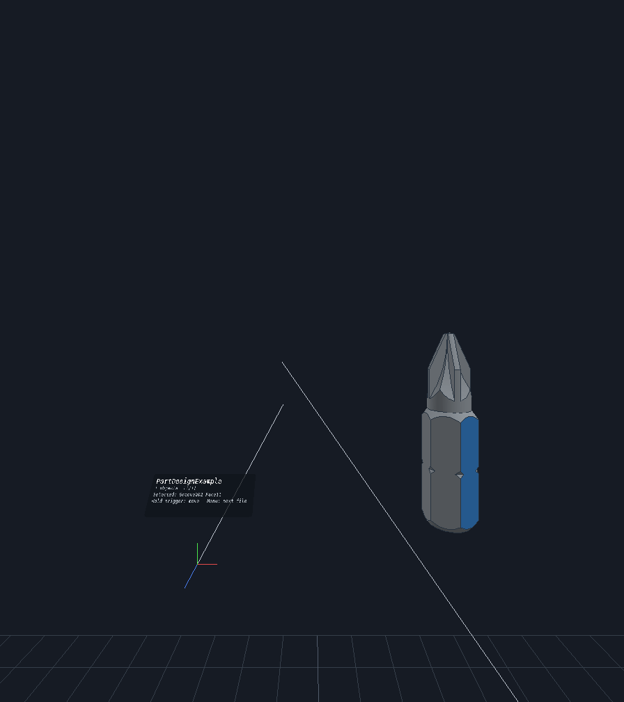

# MobileCAD XR

FreeCAD models in mixed reality on **Meta Quest 3** (and other Android OpenXR headsets): a variation of
[MobileCAD](https://github.com/LucasCoraca/mobilecad) that runs the same on-device FreeCAD engine and shows your
documents in OpenXR. It comes with a **headset-free test bench**, so you can develop and try it without a Quest.



## On the headset

| Controller | Does |
|---|---|
| Aim + trigger click on a face | Select it (FreeCAD `Face<i>` of that object) |
| Hold trigger or grip on the model | Grab it: move and turn it with your hand |
| Hold with both hands | Scale and turn it between your hands |
| Thumbstick | Up/down scales, left/right turns |
| A / X (menu) | Next document |

The info panel above your left hand shows the document, the selection and these controls. FreeCAD's example
projects ship with the app (Part Design, Assembly, FEM, BIM, Part).

**Install on a Quest 3:** enable developer mode (Meta Horizon app → Devices → Developer mode), connect the headset by
USB, then `adb install MobileCAD-XR-quest.apk` (or drag the APK into Meta Quest Developer Hub). It appears under
*Library → Unknown sources*. On a phone or the Android emulator, where there is no OpenXR runtime, the app opens a touch
preview of the same scene instead.

## Test without a headset

`sim/` is a Docker image with **Monado**, the open-source OpenXR runtime, using its *qwerty* driver: a simulated headset
and two controllers driven by keyboard and mouse, on a virtual display with software rendering (no GPU needed). The
desktop build of MobileCAD XR (`desktop/`) runs the **same XR core** as the Quest app against it.

```sh
sim/run.sh          # then open http://localhost:6080/vnc.html and press Connect
sim/run.sh --test   # automated: scripted controller selects a face, grabs and moves the model (exit 0 = pass)
```

In the browser, click into the **Monado!** panel on the right, then:
`W A S D` / `Q E` move the headset · arrows or right-drag look · hold `Ctrl` = left controller, hold `Alt` = right
controller · left click = trigger (click selects, hold grabs) · middle click = grip · `N` = menu (next file) ·
`T F G H` = thumbstick.

The scenes it loads (`scenes/*.mcxr`) are FreeCAD's examples exported by MobileCAD's engine
(`tools/export_scenes.py`, run inside the phone app with `mobilecad/engine/fcrun.sh`).

## How it is built

| Path | What |
|---|---|
| `core/` | The XR core, shared by both builds: OpenXR session and controller actions (`xr_session`), interaction (`interaction`), GL renderer for OpenGL ES 3 and desktop GL 3.3 (`renderer`), FreeCAD meshes and face picking (`scene`) |
| `android/` | The headset app (Gradle). Compiles MobileCAD's `Engine` and JNI bridge from the submodule, adds the Khronos OpenXR loader, runs the core on an OpenXR thread (`xr_android.cpp`, `XrActivity.kt`). Flavors: `arm64` (Quest), `x86` (emulator preview) |
| `desktop/` | Linux build of the core against any OpenXR runtime (Monado), with a mirror window, `--screenshot` and `--autotest` |
| `sim/` | The headset-free test bench (Monado + Xvfb + noVNC in Docker) |
| `mobilecad/` | [MobileCAD](https://github.com/LucasCoraca/mobilecad) as a git submodule: the FreeCAD engine, its build scripts and runtime packaging |

Build the Quest APK (after building MobileCAD's native runtime, see its README):

```sh
git submodule update --init
python3 -I mobilecad/engine/package_runtime.py arm64-v8a android
cd android && ./gradlew :app:assembleArm64Release
```

## License

GPL-3.0-or-later, like MobileCAD. Includes FreeCAD (LGPL-2.1-or-later), the Khronos OpenXR loader (Apache-2.0) and
MobileCAD's other components (see MobileCAD's About ▸ Open-source licenses). The test bench uses Monado (Boost
Software License 1.0), installed from Ubuntu's packages. MobileCAD XR is an independent project, not affiliated with,
sponsored or endorsed by the FreeCAD project, Meta or the Khronos Group. FreeCAD is a trademark of the FreeCAD Project
Association; Meta Quest is a trademark of Meta Platforms; OpenXR is a trademark of the Khronos Group.
